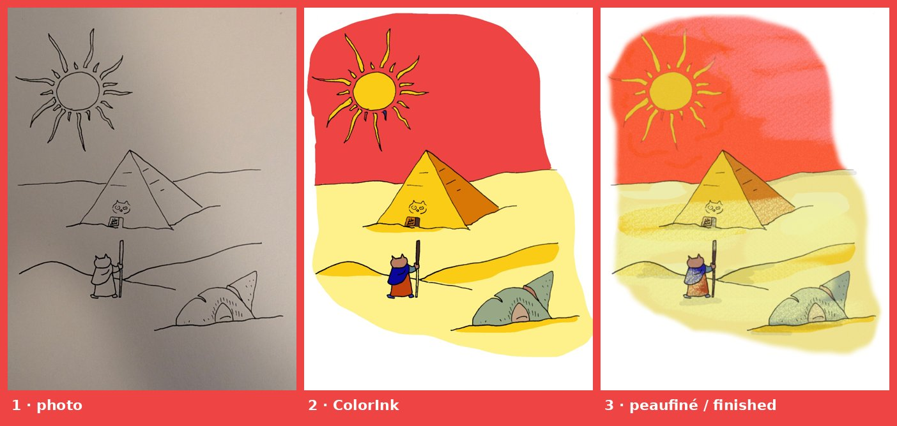

# ColorInk

**scanne · nettoie · ajoute des calques pour les couleurs**
*scan · clean · add layers for colours*



[Français](#français) · [English](#english)

---

## Français

ColorInk prépare un dessin à l'encre pour la mise en couleur. À partir d'une photo ou d'un scan, il :

1. retire le papier (le trait devient un calque transparent), en corrigeant les ombres et les dégradés d'une photo ;
2. crée un aplat de couleur par forme fermée, sous le trait ;
3. exporte un **PSD en calques** (Trait / Aplats / Papier), à reprendre dans votre logiciel de dessin.

Le mode d'emploi illustré est dans [`docs/guide.html`](docs/guide.html) (à ouvrir dans un navigateur, ou depuis le bouton *How to* de l'application).

### Ce que fait l'application

- **Réglages** : correction d'éclairage, balance papier/encre, fermeture des trous du trait (0 à 20 px), sensibilité du trait.
- **Guides** à tracer à la main : *Fermer* (rouge) sépare deux zones, *Ouvrir* (vert) en réunit deux, *Exclure* (violet) fait ignorer une zone entourée (le texte d'une bulle…), avec gomme, lissage, zoom et annulation. Les guides n'apparaissent pas dans le résultat.
- **Couleurs** : pot de peinture, palette complète (40 couleurs) ou simple (14), import d'une palette Krita / GIMP (`.gpl`). Les zones non peintes restent dans des nuances de bleu toutes différentes.
- **Export** : PSD avec de vrais calques, sans masque ; option *un calque par îlot* (rangés dans un groupe Aplats) ; image finie en PNG.
- Interface en **français et en anglais** (bouton de bascule).

### Vérifié

- Testé sous **Linux**.
- Les PSD produits s'ouvrent dans **Krita 5.2** et **GIMP 2.10** avec tous les calques, sans masque, et un rendu identique.
- Une fois installé, ColorInk **n'établit aucune connexion vers l'extérieur** : les statistiques d'utilisation de Gradio sont désactivées et la police est incluse. Vos dessins restent sur votre ordinateur.

### Installer et lancer

Il faut une connexion Internet **au premier lancement** : le lanceur installe [uv](https://docs.astral.sh/uv/) s'il n'est pas déjà là, puis uv télécharge Python (3.12) et les bibliothèques. Les lancements suivants démarrent directement.

**Linux** (testé) : dans un terminal ouvert dans le dossier de ColorInk :

```sh
sh lancer.sh
```

Le lanceur ajoute un raccourci « ColorInk » avec son icône au menu des applications ; ensuite, il suffit de l'utiliser. L'application s'ouvre dans le navigateur, à l'adresse `http://127.0.0.1:7860`.

**Windows** : double-clic sur `lancer.bat`. **macOS** : double-clic sur `lancer.command`.
⚠️ Ces deux lanceurs sont fournis mais **n'ont pas été testés**. Retours bienvenus.

**Sans les lanceurs**, sous Linux (Python ≥ 3.11) :

```sh
python3 -m venv .venv
.venv/bin/pip install -r requirements.txt
.venv/bin/python interface.py
```

### Ligne de commande

Sans interface, pour traiter des images ou des dossiers entiers :

```sh
python colorink.py dessin.jpg autre_dossier/ --trous 6 --calques
```

Options : `--trous` (px), `--seuil` (0-1), `--balance` (0-0.9), `--sans-eclairage`, `--calques` (un calque par îlot), `--ora` (OpenRaster au lieu de PSD), `--en` (noms de calques en anglais). Le résultat est écrit à côté de l'image, avec le suffixe `_colorink.psd`.

### État du projet

Le projet est terminé de mon côté : il fait ce dont j'ai besoin. Tout est là pour le reprendre : l'architecture, les choix et les pièges sont décrits dans [`CONTINUER.md`](CONTINUER.md). Les forks sont les bienvenus.

### Licence

[MIT](LICENSE), © 2026 Martin Guillaumie. La police Outfit (`polices/`) est sous licence SIL OFL 1.1.

---

## English

ColorInk prepares an ink drawing for colouring. From a photo or a scan, it:

1. removes the paper (the line art becomes a transparent layer), correcting the shadows and gradients of a photo;
2. creates one flat colour per closed shape, under the line art;
3. exports a **layered PSD** (Line art / Flats / Paper) to finish in your drawing software.

The illustrated user guide is in [`docs/guide.html`](docs/guide.html) (open it in a browser, or from the *How to* button in the app).

### What the app does

- **Settings**: lighting correction, paper/ink balance, gap closing (0 to 20 px), line sensitivity.
- Hand-drawn **guides**: *Close* (red) splits two zones, *Open* (green) merges two, *Exclude* (purple) ignores a circled area (the text in a speech bubble…), with eraser, smoothing, zoom and undo. Guides do not appear in the result.
- **Colours**: paint bucket, full palette (40 colours) or simple palette (14), import of a Krita / GIMP palette (`.gpl`). Unpainted zones stay in distinct shades of blue.
- **Export**: PSD with real layers and no masks; *one layer per island* option (inside a Flats group); finished image as PNG.
- Interface in **French and English** (toggle button).

### Verified

- Tested on **Linux**.
- The PSD files open in **Krita 5.2** and **GIMP 2.10** with all layers, no masks, and identical rendering.
- Once installed, ColorInk **makes no outside connections**: Gradio usage statistics are turned off and the font is bundled. Your drawings stay on your computer.

### Install and run

An Internet connection is needed **on the first run**: the launcher installs [uv](https://docs.astral.sh/uv/) if it is missing, then uv downloads Python (3.12) and the libraries. Later runs start straight away.

**Linux** (tested): in a terminal opened in the ColorInk folder:

```sh
sh lancer.sh
```

The launcher adds a "ColorInk" shortcut with its icon to the applications menu; after that, just use it. The app opens in your browser at `http://127.0.0.1:7860`.

**Windows**: double-click `lancer.bat`. **macOS**: double-click `lancer.command`.
⚠️ These two launchers are provided but **have not been tested**. Feedback welcome.

**Without the launchers**, on Linux (Python ≥ 3.11):

```sh
python3 -m venv .venv
.venv/bin/pip install -r requirements.txt
.venv/bin/python interface.py
```

### Command line

Without the interface, to process images or whole folders:

```sh
python colorink.py drawing.jpg other_folder/ --trous 6 --calques --en
```

Options: `--trous` (gap closing, px), `--seuil` (line threshold, 0-1), `--balance` (0-0.9), `--sans-eclairage` (no lighting correction), `--calques` (one layer per island), `--ora` (OpenRaster instead of PSD), `--en` (English layer names). The result is written next to the image with the `_colorink.psd` suffix.

### Project status

The project is finished on my side: it does what I need. Everything is here to take it further: architecture, choices and pitfalls are described in [`CONTRIBUTING.md`](CONTRIBUTING.md). Forks are welcome.

### Licence

[MIT](LICENSE), © 2026 Martin Guillaumie. The Outfit font (`polices/`) is under the SIL OFL 1.1.
